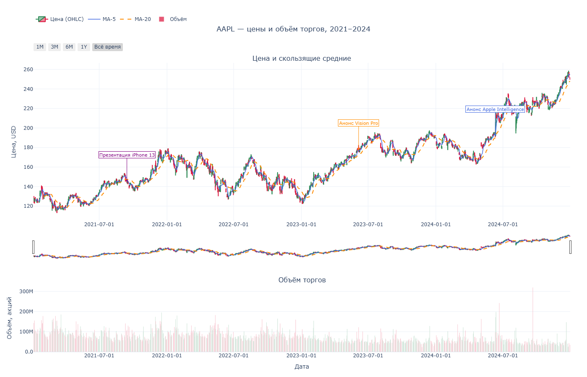
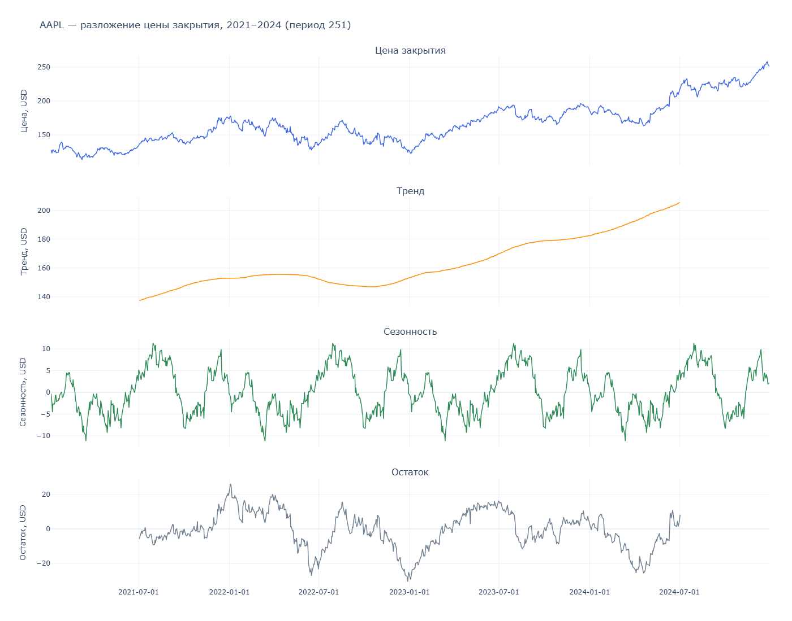
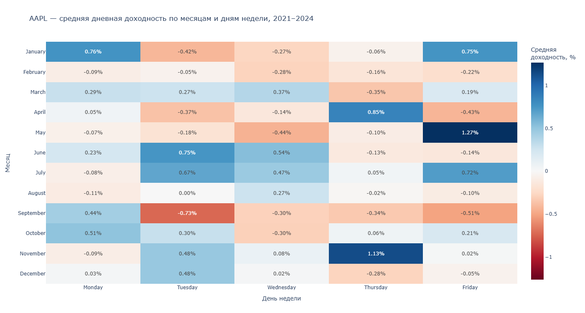
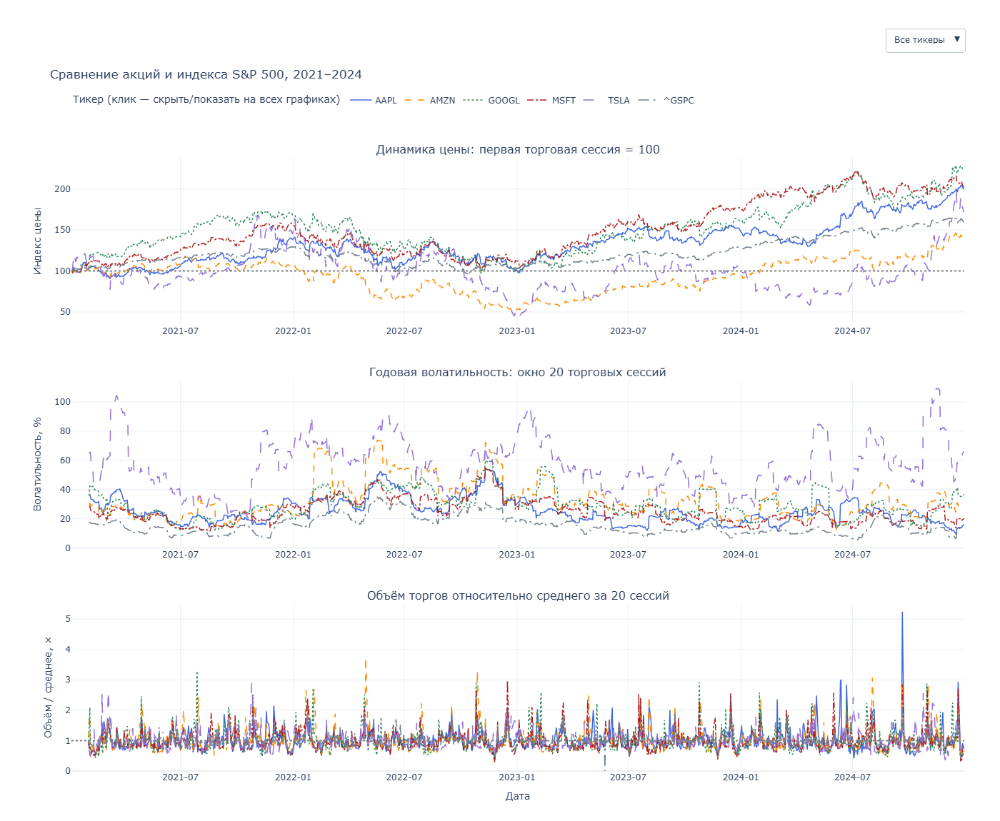

# Графики к Dynamic visualization

Код и выводы — в [ноутбуке](../Dynamic%20visualization.ipynb). Данные — в [stocks_2021_2024.csv](../stocks_2021_2024.csv).

Для интерактивного просмотра скачайте HTML и откройте в браузере. На GitHub доступны только статические превью.

## Задание 1

[task_1.html](task_1.html) — свечной график AAPL, MA-5, MA-20 и объём торгов за 2021–2024 годы. Период можно выбирать кнопками и ползунком.

События на графике:

- [Презентация iPhone 13, 14.09.2021](https://www.apple.com/newsroom/2021/09/apple-introduces-iphone-13-and-iphone-13-mini/)
- [Анонс Vision Pro, 05.06.2023](https://www.apple.com/newsroom/2023/06/introducing-apple-vision-pro/)
- [Анонс Apple Intelligence, 10.06.2024](https://www.apple.com/newsroom/2024/06/introducing-apple-intelligence-for-iphone-ipad-and-mac/)

## Задание 2

[ts_season_1.html](ts_season_1.html) — цена закрытия AAPL, тренд, сезонность и остаток. Период разложения — 251 торговая сессия.

[ts_season_2.html](ts_season_2.html) — средняя дневная доходность AAPL по месяцам и дням недели.

## Задание 3

[task_3.html](task_3.html) — сравнение тикеров: индекс цены с начальным значением 100, волатильность и относительный объём торгов. Выбор тикера, легенда и масштабирование по времени связаны между тремя панелями.

## Задание 4

[task_4.html](task_4.html) — график Bokeh: цена закрытия и MA20 за последние 252 торговые сессии. Можно выбрать тикер, отключить линии через легенду и посмотреть значения при наведении.

График также выводится в ноутбуке. Кнопка Save на панели Bokeh сохраняет его в PNG.
